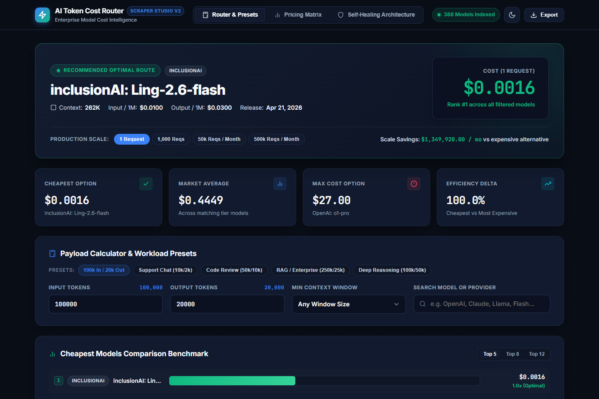
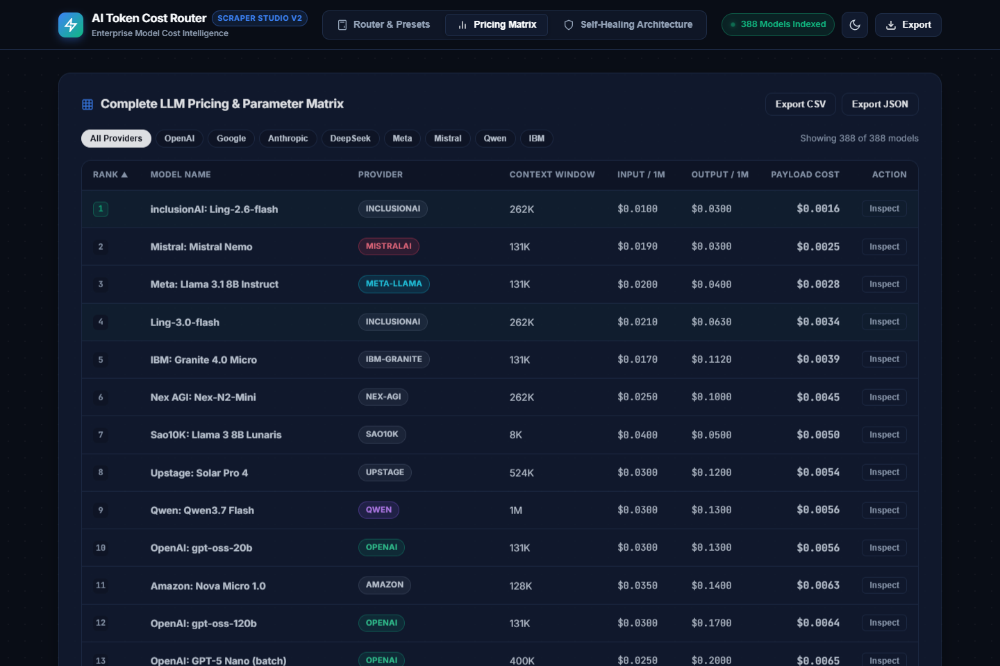
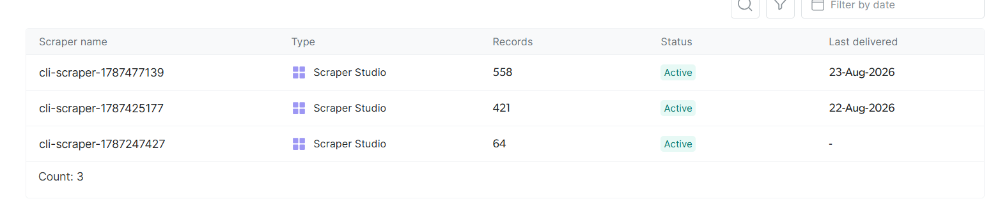
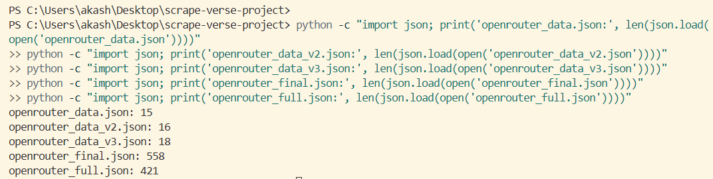

# ⚡ AI Token Cost Router

<div align="center">

[](https://brightdata.com/products/scraper-studio)
[](https://wemakedevs.org)
[](#-dataset--parameters)
[](#-enterprise-design-system)
[](#-running-locally)

**Enterprise-grade LLM routing intelligence that identifies the optimal, lowest-cost AI model for any custom workload.**  
Powered by a self-healing scraping pipeline built with **Bright Data Scraper Studio**.

[Live Demo](https://akashnarayanan007.github.io/ai-token-cost-router/) • [Demo Video](https://www.youtube.com) • [Scraper Studio Architecture](#-the-self-healing-scraping-journey) • [Quickstart](#-running-locally)

</div>

---

## 📸 Interface Overview

### 1. Optimal Route Decision Engine & Workload Benchmarks

*High-contrast executive dashboard highlighting the optimal model, real-world developer workload presets (Short Chat, Code Review, Enterprise RAG, Deep Reasoning), production scale multipliers (1 to 500k reqs/mo), and top model comparison bar charts with exact cost multipliers.*

### 2. Complete Pricing Matrix & Parameter Deep-Dive

*Sortable pricing matrix covering 388 LLMs with 1-click provider filters (OpenAI, Google, Anthropic, DeepSeek, Meta, Mistral, Qwen, IBM Granite), context window filters, live search, and model code inspection.*

---

## 📖 Executive Summary

Modern AI applications consume millions of input and output tokens daily. OpenRouter indexes hundreds of models across dozens of providers with volatile, fast-changing pricing structures. Manually calculating, tracking, and comparing costs across model variants is inefficient and error-prone.

**AI Token Cost Router** solves this with a two-part system:
1. **Automated, Self-Healing Data Pipeline**: Built using **Bright Data Scraper Studio**, extracting live model pricing, token rates, and context window limits directly from OpenRouter.
2. **Enterprise Cost Optimization Dashboard**: A high-contrast, zero-latency web application that evaluates your exact token payload, models production volume economics, and outputs the optimal model with ready-to-run OpenAI-compatible Python API integration code.

---

## 🧠 The Self-Healing Scraping Journey

The scraping pipeline was developed and iteratively self-healed using the **Bright Data Scraper Studio CLI (`bdata`)**.

```
[Attempt 1: DOM Scraper] ──(15 models)──> [Heal #1: Scroll Trigger] ──(16 models)──>
[Heal #2: Deep Heuristics] ──(18 models)──> [Strategic Pivot to JSON API] ──(421 models)──>
[Parameter Fix: ?output_modalities=all] ──(558 raw models / 388 active pricing models)
```

### Detailed Progression:

1. **Initial Attempt (Rendered HTML Table)**:
   - Scraped `https://openrouter.ai/models` directly.
   - Page hydration and infinite scroll limited the initial collector capture to **15 models**.
2. **Heal Attempt #1 (`bdata scraper heal`)**:
   - Dispatched self-healing instruction: *"Wait for DOM hydration and scroll to reveal list elements"*.
   - Result: 15 → **16 models**.
3. **Heal Attempt #2 (Deep Scroll Heuristic)**:
   - Provided aggressive scroll targeting instructions.
   - Result: 16 → **18 models**, confirming that DOM scraping against infinite virtualized tables yielded diminished returns.
4. **Strategic Architectural Pivot (API Discovery)**:
   - Inspected network activity and discovered OpenRouter's underlying public JSON API (`https://openrouter.ai/api/v1/models`).
   - Re-configured Scraper Studio to target the structured JSON API payload directly.
   - Result: Immediately surged to **421 models**.
5. **Final Optimization (Multimodal Coverage)**:
   - Identified that default API responses omit multimodal and specialized models.
   - Appended `?output_modalities=all`.
   - Result: Landed at the complete catalog of **558 total models** (388 active commercial LLMs with complete input/output pricing).

### Proof of Scraper Studio Progression

*Bright Data Scraper Studio dashboard verifying collector progression from initial attempts to final 558-record run.*


*Local terminal audit validating model count progression across each phase of the project.*

---

## 🛠️ Bright Data Collectors Summary

| Collector ID | Target Endpoint | Strategy | Extracted Records | Status |
| :--- | :--- | :--- | :--- | :--- |
| `c_mt1syvpq8qmnfk802` | `openrouter.ai/models` | DOM Table Scraper + Healing | 15–18 models | Kept for audit & comparison |
| `c_mt5lqt7s21ptwuiesf` | `openrouter.ai/api/v1/models` | Structured API Scraper (`output_modalities=all`) | **558 models** | **Active Production Pipeline** |

---

## ⚡ Core Dashboard Capabilities

### 1. Payload & Production Volume Modeling
- **Custom Input/Output Counters**: Enter custom prompt and completion token counts with real-time reactive calculations.
- **Developer Workload Presets**:
  - `100k In / 20k Out`: Standard balanced workload
  - `Support Chat (10k/2k)`: Low-latency conversational queries
  - `Code Review (50k/10k)`: Large context code analysis
  - `Enterprise RAG (250k/25k)`: Document retrieval and summarization
  - `Deep Reasoning (100k/50k)`: High-output reasoning models (DeepSeek R1, OpenAI o1)
- **Production Scale Multipliers**: Simulate costs for single queries, `1,000 requests`, `50,000 requests/month`, or `500,000 requests/month` to project enterprise infrastructure budgets and dollar savings.

### 2. Relative Cost Multiplier Benchmarks
- Dynamic horizontal bar charts comparing the top **5**, **8**, or **12** cheapest options.
- Visual multiplier tags comparing every alternative against the winner (e.g. `1.0x (Optimal)` vs `2.4x cost`, `12.5x cost`).

### 3. Comprehensive Pricing Matrix
- Filterable by Provider: **OpenAI**, **Google**, **Anthropic**, **DeepSeek**, **Meta**, **Mistral**, **Qwen**, **IBM Granite**, and more.
- Filterable by Context Window: `32K+`, `128K+`, `256K+`, and `1M+` tokens.
- Instant search across model names, providers, and slug IDs.
- Sortable headers by Rank, Name, Provider, Context Window, Input Rate, Output Rate, and Payload Cost.

### 4. Interactive Model Code Inspector
- Click **"Inspect"** on any model to view its full specification breakdown.
- Automatically generates copy-ready, OpenAI-compatible Python API integration code pre-populated with that model's identifier.

### 5. Data Export
- 1-click export of current filtered models to **CSV** or **JSON**.

---

## 🚀 Running Locally

The dashboard is completely self-contained with no external runtime dependencies, npm build steps, or backend servers required.

### Quick Start (Local Web Server)
```powershell
python -m http.server 8000
```
Open **[http://localhost:8000](http://localhost:8000)** in any modern web browser.

### Direct Launch
```powershell
Start-Process .\index.html
```

---

## 🔄 Re-running the Bright Data Scraper

To re-execute the scraping pipeline using the Bright Data CLI:

```bash
# 1. Authenticate with Bright Data
npx -p @brightdata/cli bdata login

# 2. Trigger the production API collector
bdata scraper run c_mt5lqt7s21ptwuiesf "https://openrouter.ai/api/v1/models?output_modalities=all" --pretty -o openrouter_final.json

# 3. Regenerate dashboard with the latest dataset
python upgrade_dashboard.py
```

---

## 📁 Repository Structure

```
.
├── index.html                  # Production dashboard (data embedded, zero dependencies)
├── openrouter_final.json       # Scraped dataset from Scraper Studio (558 raw models)
├── upgrade_dashboard.py        # Python dashboard compiler & dataset parser
├── dashboard-preview.png       # UI Preview: Cost Router & Workload Benchmark
├── matrix-preview.png          # UI Preview: Pricing & Parameter Matrix
├── scraper-proof.png           # Scraper Studio collector audit screenshot
├── data-count-proof.png        # Local CLI count verification screenshot
├── README.md                   # Project documentation
└── final-submission/           # Standalone hackathon bundle
    ├── index.html              # Standalone distribution
    ├── data.json               # Extracted dataset
    ├── dashboard-preview.png   # Screenshot
    ├── matrix-preview.png      # Screenshot
    ├── scraper-proof.png       # Proof screenshot
    ├── data-count-proof.png    # Proof screenshot
    └── README.md               # Submission documentation
```

---

## 🤖 AI Disclosure & Attribution

This project was developed for the **Into the Scrape-Verse Hackathon** (WeMakeDevs × Bright Data, August 2026).
- **Bright Data Scraper Studio**: Powers the automated extraction and self-healing data pipeline via `bdata`.
- **Assisting AI**: Anthropic Claude & Google Gemini were utilized for iterative architecture planning, data transformation scripts, and UI refinement.
- **Review & Validation**: All scraping logic, selector definitions, token arithmetic, and code implementations were inspected, verified, and audited by the author.
